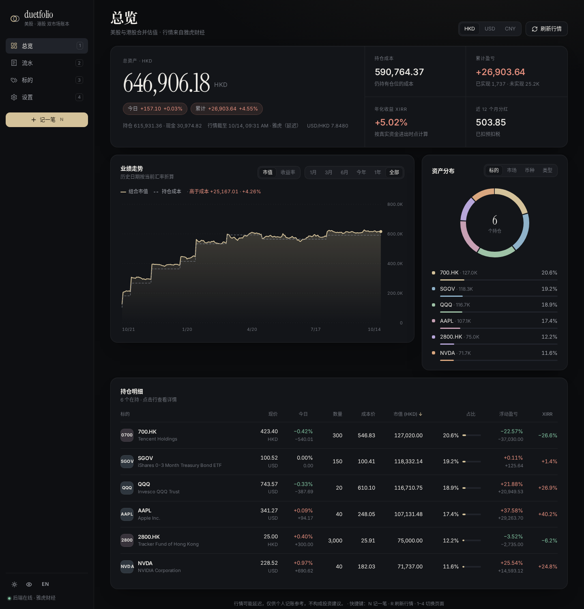
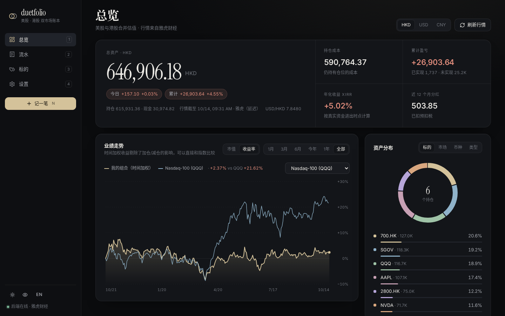

**English** | [简体中文](README.md)

# duetfolio ◈

[](https://github.com/TTNAN/duetfolio/actions/workflows/test.yml)
[](https://render.com/deploy?repo=https://github.com/TTNAN/duetfolio)

**Holding both US and HK stocks? One glance tells you the total P&L in your home currency.**



---

## What it is

duetfolio is a portfolio tracker that runs on your own computer, built for people who hold **both US and Hong Kong stocks**:

- Both markets' positions on one screen — no more switching between broker apps
- USD and HKD holdings auto-converted into your base currency (HKD / USD / CNY)
- Every buy, sell and dividend timestamped and sized into a true **annualized return (XIRR)** — not just "up a few percent"

No sign-up, no data uploads. Your ledger lives in a local SQLite file.

### New in v0.3

- **Stock splits & consolidations**: a new "Split" entry takes the ratio (4 for 1-for-4, 0.1 for 10-to-1); share count updates, total cost stays, and the history curve shows no fake crash on the split date
- **Average cost or FIFO**: switch the cost-basis method in Settings so realized/unrealized P&L match your broker (total P&L and XIRR are unaffected)
- **Broker exports as-is**: built-in presets for Futu / moomoo, Tiger, IBKR and Schwab — no column renaming; itemized fees are summed
- **Docker fixed**: the frontend image no longer fails to build; nginx proxies `/api` so it works on a NAS or remote server; the API runs as non-root with pinned dependencies
- **Faster**: portfolio results are cached per data version (recomputed only when data changes); quotes fetched in the last 5 minutes aren't re-fetched, even across restarts
- **Sturdier XIRR**: frequent large, alternating flows converge (Brent's method takes over when Newton stalls)
- **Keyboard & mobile**: Esc closes dialogs, focus stays inside them, arrow keys step through chart days; wide tables scroll sideways on phones with the symbol column pinned
- **Live demo mode**: `DEMO_MODE=true` serves a read-only fictional portfolio, wired to the Deploy button

### New in v0.2

- **Redesigned UI**: sidebar layout, serif headline figures, dark & light themes, mobile bottom nav, bundled fonts (works offline)
- **Today's P&L** right under total assets
- **Beat the market?** The Return view plots time-weighted return (unaffected by top-ups) against Nasdaq-100 / S&P 500 / Hang Seng / HS TECH
- **One-click history backfill**: daily closes since your first trade, so the curve is there immediately
- **Holding drawer**: price chart with buy/sell markers and per-position XIRR
- **Red-up / green-up** color convention toggle, **privacy mode** for screenshots
- **CSV export, full backup / restore**, shortcuts `N` add · `R` refresh · `1–4` pages



## 3-minute start (Windows)

1. Install Python ([official site](https://www.python.org/downloads/), tick **Add python.exe to PATH**)
2. Click the green **Code** button → **Download ZIP**, extract
3. Open PowerShell in the project folder and run **`& .\start.ps1`** (wait for dependencies on first run), your dashboard opens in the browser

> If it says scripts are disabled, run `Set-ExecutionPolicy -Scope CurrentUser -ExecutionPolicy RemoteSigned` once (type `Y`), then the command above.
> It opens [http://127.0.0.1:8000](http://127.0.0.1:8000) — the backend also serves the frontend, so **only one window** stays open. Close it to stop.
> Alternative: double-click `start.bat` (the batch window may flash-close on some systems; use the PowerShell method instead).
> API docs only: [http://127.0.0.1:8000/docs](http://127.0.0.1:8000/docs)
> Manual frontend dev: `cd frontend && npm install && npm run dev` (Node.js 18+, page then lives on `:5173`)

## Your first entry

**① Add an instrument** — open the Instruments tab, search `03152`, `SGOV`, `腾讯` or `博时`, click a result to auto-fill symbol, market and currency, save.

**② Record a buy** — open the Transactions tab, pick the instrument, enter quantity, price and date, save. Position size and average cost are computed for you.

**③ Refresh quotes** — hit "Refresh" on the dashboard: total value, P&L and XIRR appear, with a "quotes as of" timestamp next to the button.

> Lots of trades? Transactions → **Import broker CSV** supports raw Futu, Tiger, IBKR and Schwab exports (pick the broker or auto-detect) — preview first, confirm to write; unknown tickers auto-create instruments.
> Deposits/withdrawals? The **Cash** card at the bottom of Transactions records money in/out, and XIRR counts it — the annualized figure becomes "what this money earned", not just "what these tickers earned".

## FAQ

**How do I write HK symbols?**
Just search and click — no manual formatting needed. If you type them: Yahoo format strips leading zeros, `03152` → `3152.HK`, `00700` → `700.HK`; US tickers as-is (`AAPL`, `SGOV`).

**How is total P&L computed?**
Total P&L = unrealized (price − remaining cost basis) + realized (sells and dividends, net of fees). "Invested" on the page is the cost of the **currently held** position, not lifetime deposits.

**Why is XIRR absurdly large?**
XIRR is annualized — 0.1% over 4 days annualizes to a wild number. That's math, not a bug; it settles as the holding period grows. Each flow converts FX at the **transaction date's** rate (captured automatically), so FX noise never leaks into investment returns.

**How good are the quotes?**
**East Money** by default (closer to real-time); if it misses a symbol, **Yahoo Finance** fills in (~15 min delayed). Every quote records its actual source, shown next to "quotes as of".

**How is the net-worth curve drawn?**
Daily total = that day's position sizes × that day's closes, replayed from stored snapshots only (no live fetching). Historical days convert FX at **today's** rate — curve shape is trustworthy, old absolute values are approximate (noted next to the chart).

**Where is my data?**
Local SQLite file (`backend/duetfolio.db`). Nothing leaves your machine.

---

## Architecture (for developers)

```
frontend/  React 18 + Vite, hand-rolled SVG charts (zero chart deps)
backend/   FastAPI + SQLAlchemy 2.0 + Alembic + Pydantic v2
db         SQLite (zero-config default) / PostgreSQL (via DATABASE_URL)
```

### Conventions

- **Positions & cost**: weighted average cost by default (`COST_METHOD=fifo` or the Settings toggle for FIFO lots). Sell fees reduce proceeds, never the remaining basis; cost hits zero on full exit. Total P&L and XIRR are identical under both methods — only the realized/unrealized split moves.
- **Splits**: transaction type `split`, `quantity` holds the ratio. Shares × ratio, lot unit cost ÷ ratio, total cost unchanged, no cash flow. Yahoo/East Money daily closes are split-adjusted, so pre-split history is valued at shares × all later split ratios; recording or deleting a split drops that instrument's stored closes and re-fetches adjusted history.
- **XIRR**: pure Python (`backend/app/services/xirr.py`): Newton-Raphson with an analytic derivative; if it stalls, scan −99.99%…+1000% for sign changes and solve each bracket with Brent's method; with several roots, take the one nearest 10%. Without cash movements: buys (negative, incl. fees) / sells & dividends (positive, net of fees), terminal = position value. Once deposits/withdrawals are recorded it switches to the account view: only deposits (negative) / withdrawals (positive) are flows, terminal = positions + idle cash (v0.1 mixed both and counted the same money twice). Terminal dated at the **latest quote date**. Each holding also gets its own XIRR. Returns null on <2 flows or single-signed flows.
- **Time-weighted return**: `r_d = (V_d + dividends_d) / (V_{d-1} + net_buys_d) − 1`, chained daily; benchmarks (SPY / QQQ / 2800.HK / 3033.HK) rebased to the first day of the range.
- **FX**: each transaction captures the **trade-date** FX into `fx_to_hkd`; XIRR flows convert at that rate. Latest rates cached 10 min TTL.
- **Missing-data circuit breaker**: if any holding lacks a quote or any currency lacks FX, totals and XIRR go null (with a banner naming the gaps) — no "partially trustworthy" numbers.

### Market-data design

`BaseProvider` abstraction in `backend/app/services/market.py`, switched by `MARKET_PROVIDER` (default `yfinance`, `eastmoney` optional).

- **Primary/backup chain**: `refresh_all` tries the primary provider per symbol, then the backup before marking failed. Snapshots record the **actual** `source`/`fetched_at`, which the dashboard's "quotes as of" label reads.
- **eastmoney**: unofficial push2 API (`f43` latest / `f60` prev close); symbols mapped via the suggest API (`3152.HK` → `116.03152`, leading zeros restored); FX via yfinance (East Money has no reliable forex endpoint).
- **Symbol search**: `GET /api/instruments/search` queries Yahoo search + East Money suggest concurrently (generic + `mktnum=116` HK-only pass, so mainland funds can't crowd HK ETFs out of the ranking), dedupes, keeps US/HK only.

### API reference

| Method | Path | Notes |
|---|---|---|
| GET | `/api/health` | liveness |
| GET/POST/DELETE | `/api/instruments…` | instruments |
| GET | `/api/instruments/search?q=` | fuzzy symbol/CJK-name search |
| GET/POST/PUT/DELETE | `/api/transactions…` | flows, incl. inline edit |
| POST | `/api/transactions/import/preview?broker=` | broker CSV parse preview (`auto`/`futu`/`tiger`/`ibkr`/`schwab`/`generic`) |
| POST | `/api/transactions/import` | confirm import (unknown tickers auto-created) |
| GET/POST/DELETE | `/api/cash…` | deposits/withdrawals |
| GET | `/api/portfolio/summary?base=&method=` | totals, XIRR, dividends, holdings (`method=wac|fifo`) |
| GET | `/api/portfolio/history?base=&method=` | curve points (value / cost / time-weighted return) |
| POST | `/api/prices/backfill` | backfill daily closes since first trade (missing days only) |
| GET | `/api/benchmark?symbol=&start=` | benchmark daily closes (1h cache) |
| GET | `/api/instruments/{id}/prices` | stored daily closes for one instrument |
| GET | `/api/transactions/export.csv` | export all transactions |
| GET / POST | `/api/backup` · `/api/backup/restore` | full backup / validated restore |
| POST | `/api/prices/refresh?force=` | refresh all quotes (8-thread pool; skips quotes < 5 min old unless `force=true`) |

Interactive docs at `/docs` once the backend is running.

### Local development

```bash
cd backend
python -m venv .venv && .venv/bin/pip install -r requirements.txt -r requirements-dev.txt
.venv/bin/uvicorn app.main:app --reload   # migrations run automatically on boot
.venv/bin/python -m pytest tests/         # 47 tests

cd ../frontend
npm install && npm run dev
npm run lint                              # ESLint (also runs in CI)
```

### Configuration (env vars)

| Variable | Default | Notes |
|---|---|---|
| `MARKET_PROVIDER` | `yfinance` | primary quote source; `eastmoney` switches. Missed symbols are retried in `yfinance → eastmoney → sina` order |
| `BASE_CURRENCY` | `HKD` | base currency |
| `DATABASE_URL` | local SQLite | `postgresql+psycopg2://…` for Postgres |
| `CORS_ORIGINS` | `*` (empty in Docker) | allowed frontend origins, comma-separated; empty = same-origin only |
| `COST_METHOD` | `wac` | default cost basis: `wac` average / `fifo` |
| `QUOTE_TTL_SECONDS` | `300` | don't re-fetch quotes younger than this; `0` disables |
| `DEMO_MODE` | unset | `true` = read-only live demo (seeds a fictional portfolio into an empty DB) |
| `BASIC_AUTH_USER` / `BASIC_AUTH_PASS` | unset | when set, `/api/*` requires auth (except health) |
| `YFINANCE_TIMEOUT` | `15` | yfinance timeout, seconds |

### Deploy

**Docker Compose (NAS / home server / VPS)**

```bash
docker compose up -d --build
# open http://<host>:5173
```

The web container (nginx) proxies `/api/` to the API container, so the browser only ever talks to one origin — it works the same on a NAS or a remote server. Data lives in the `duetfolio-data` volume. If you expose it, enable `BASIC_AUTH_USER` / `BASIC_AUTH_PASS` in `docker-compose.yml`.

**Single container**

```bash
docker build -t duetfolio .
docker run -d -p 8000:8000 -v duetfolio-data:/data duetfolio
```

**Live demo (one click)**: the Deploy to Render button uses `render.yaml` to start a read-only demo on Render's free plan (`DEMO_MODE=true`; a fictional portfolio is seeded and its prices back-filled on every start). Free instances sleep when idle and have no persistent disk — demo only.

## Disclaimer

Quotes are delayed and may be inaccurate. This tool is for personal bookkeeping only, not investment advice.

## License

MIT

## Buy me a coffee

If this project saved you some time, coffee is welcome. ☕

| Alipay | WeChat Pay |
| ------ | ---------- |
|  |  |
